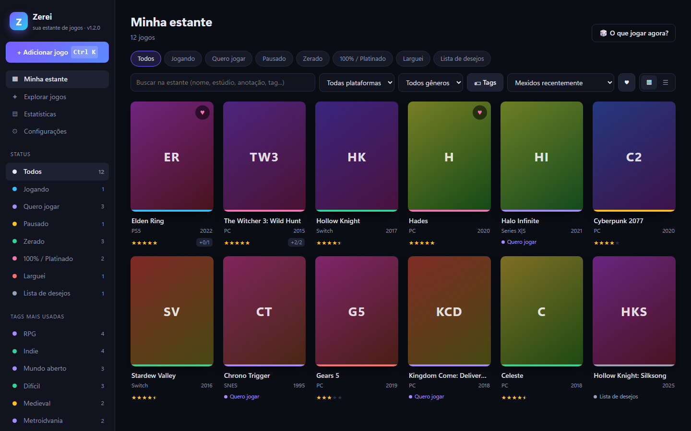
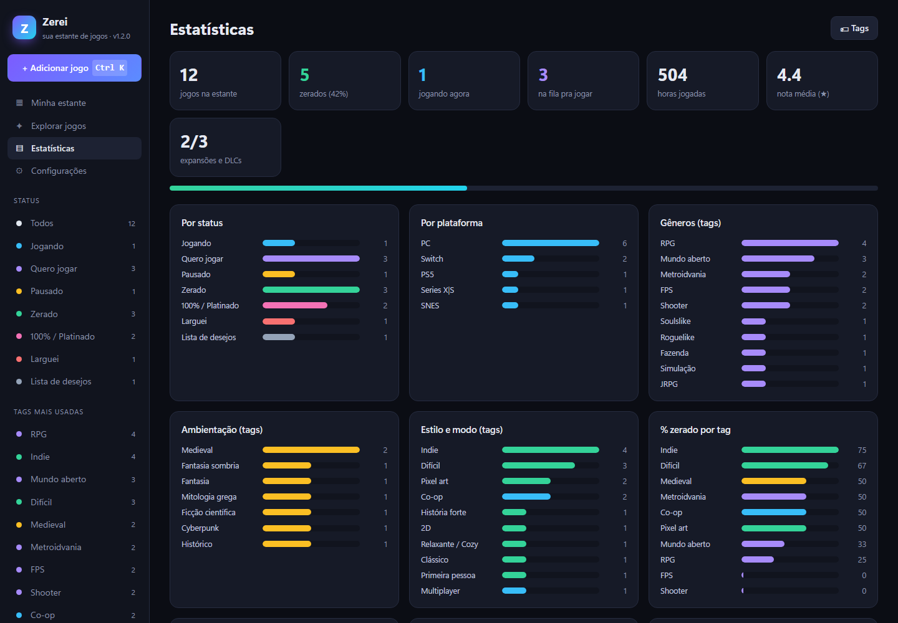

<div align="center">


# Zerei

**Sua estante de jogos no PC.**
Organize tudo o que você já zerou, está jogando e quer jogar — de qualquer plataforma.

[](https://github.com/DancingHavel/zerei/releases/latest)




</div>

---

## O que é

O **Zerei** é um programa de Windows pra quem joga muito e tem uma lista enorme de jogos.
Você busca qualquer jogo, adiciona na sua estante e marca o que já zerou, o que está jogando
e o que ainda quer jogar. Capas, fotos, plataformas, expansões e DLCs vêm prontos da
**[IGDB](https://www.igdb.com)**, o banco de jogos da Twitch, com mais de 300 mil jogos de todas as épocas.

É leve (instalador de ~2 MB), funciona sem internet e seus dados ficam **só no seu computador**.

## Funcionalidades

- 🔎 **Busca em todo o catálogo** — de Atari a PS5, com capa, ano, plataformas e nota da crítica
- 📚 **Estante com status** — Jogando, Quero jogar, Pausado, Zerado, 100%/Platinado, Larguei e Lista de desejos
- 🧩 **Expansões e DLCs** — lista completa de cada jogo, pra marcar as que você já jogou
- 🏷️ **Mais de 200 tags prontas** — RPG, FPS, TPS, Soulslike, Medieval, Cyberpunk, Co-op, Pixel art... e as tags entram **automaticamente** ao adicionar um jogo
- 🎯 **Filtros** — por status, tags (todas ou qualquer uma), plataforma, gênero, favoritos e texto
- ⭐ **Seu registro pessoal** — nota em estrelas, horas jogadas, datas de início e fim, plataforma e anotações
- 🌍 **Explorar** — mais bem avaliados, lançamentos recentes e próximos lançamentos, por plataforma
- 📊 **Estatísticas** — % zerado, horas, plataformas, gêneros, ambientações, zerados por ano, tudo filtrável por tag
- 🎲 **"O que jogar agora?"** — sorteia um jogo da sua fila
- 💾 **Backup e planilha** — exporta para `.json` e `.csv` (abre no Excel)
- 🚀 **Atualização automática** — avisa quando sai versão nova e se atualiza com um clique

<div align="center">

</div>

## Como instalar

1. Baixe o `Zerei_x.x.x_x64-setup.exe` na página de **[Releases](https://github.com/DancingHavel/zerei/releases/latest)**.
2. Execute o instalador.
3. Abra o Zerei → **Configurações** e siga o passo a passo para criar sua chave grátis da IGDB (leva uns 5 minutos, usando uma conta da Twitch).

Pronto: é só apertar **Ctrl + K** e começar a adicionar jogos.

> Seus dados ficam em `%APPDATA%\com.zerei.app\`. As chaves da IGDB e a sua lista **nunca** são enviadas para lugar nenhum.

---

## Para desenvolvedores

**Requisitos:** Node.js, Rust e Visual Studio Build Tools (C++).

```bash
npm install
npm run app          # abre o programa em modo de desenvolvimento
npm run dev          # só a interface, no navegador (abra com ?demo para ver dados de exemplo)
npm run instalador   # gera o instalador .exe
```

### Estrutura

| Pasta | O que tem |
|---|---|
| `src/` | Interface (React): estante, busca, detalhes, explorar, estatísticas, tags |
| `src-tauri/` | Parte em Rust: salva os dados no disco e conversa com a API da IGDB |
| `scripts/publicar.ps1` | Compila, assina e publica uma versão nova nos Releases |

### Publicar uma versão nova

1. Aumente a versão em `package.json`, `src-tauri/tauri.conf.json` e `src-tauri/Cargo.toml`.
2. Faça commit das mudanças.
3. Rode:

```powershell
powershell -ExecutionPolicy Bypass -File scripts\publicar.ps1 -Notas "O que mudou"
```

Os PCs com o Zerei instalado recebem o aviso de atualização ao abrir o programa.
As atualizações são assinadas com a chave em `%USERPROFILE%\.tauri\zerei.key` (que nunca vai para o repositório).

---

<div align="center">
Dados de jogos fornecidos por <a href="https://www.igdb.com">IGDB.com</a>.
</div>
